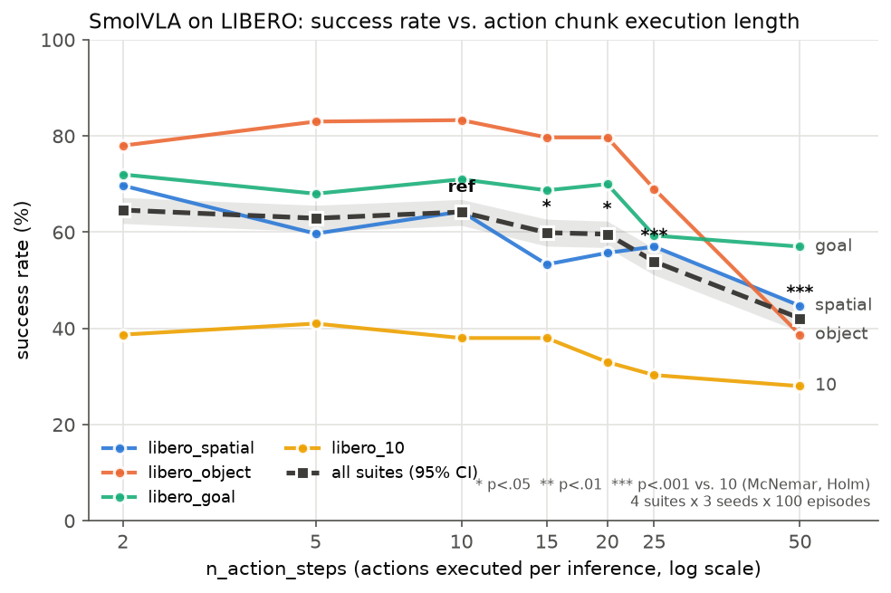
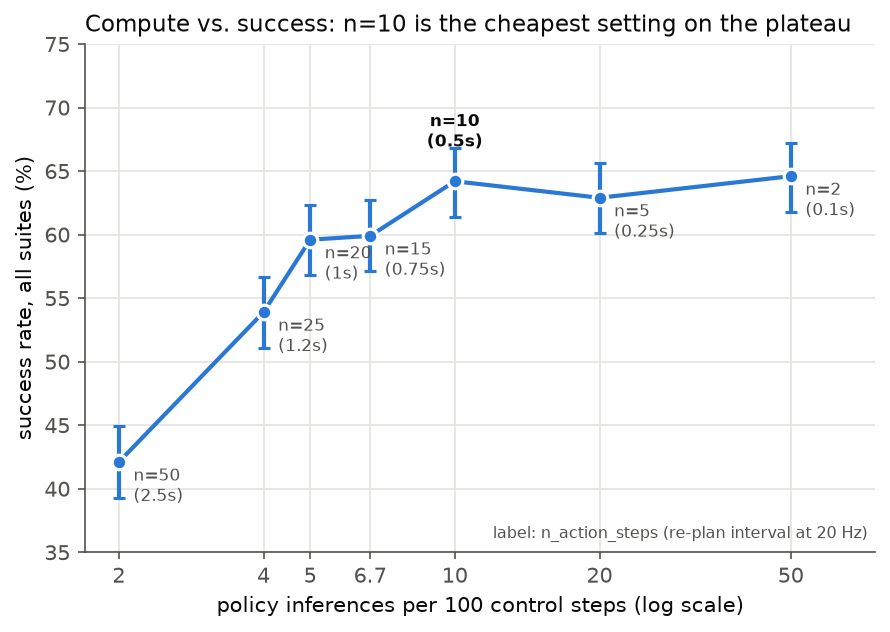
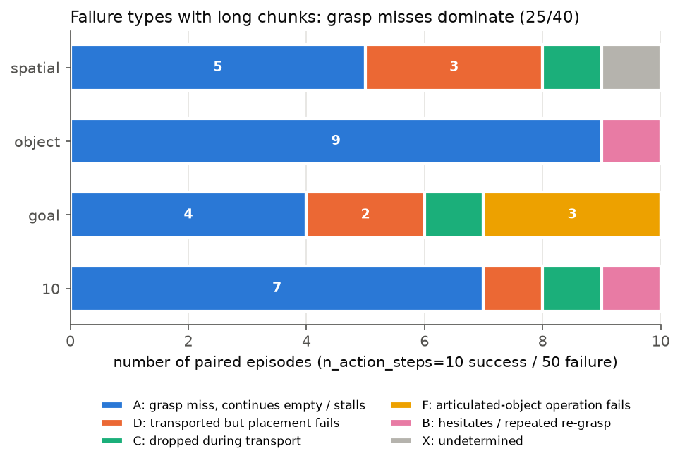

# SmolVLA の action chunk 実行長が成功率に与える影響 ― LIBERO での大規模評価

VLA（Vision-Language-Action）モデル **SmolVLA** は、1回の推論で50ステップ分の行動（action chunk）を予測します。
そのうち何ステップを実行してから再推論するか（`n_action_steps`）は、推論コストと反応性のトレードオフを決める実行時パラメータです。
本リポジトリは、この `n_action_steps` を 2〜50 の7条件で変え、LIBERO ベンチマーク4スイートで計 **8,400 エピソード** を評価した実験の、
評価・集計・可視化のパイプライン一式です。

Physical AI 講座 応用編1（MLOps・RobOps）の最終課題として作成しました。

## 結果の要約



| n_action_steps | 再推論の間隔（20 Hz） | 成功率（4スイート合算） | 95%信頼区間 | 10との差（McNemar, Holm補正） |
|---:|---:|---:|---:|---|
| 2 | 0.1 s | 64.6% | 61.8–67.2 | 差なし（p=0.91） |
| 5 | 0.25 s | 62.9% | 60.1–65.6 | 差なし（p=0.91） |
| **10** | **0.5 s** | **64.2%** | 61.4–66.8 | 基準 |
| 15 | 0.75 s | 59.9% | 57.1–62.7 | 低い（p=0.033） |
| 20 | 1.0 s | 59.6% | 56.8–62.3 | 低い（p=0.024） |
| 25 | 1.25 s | 53.9% | 51.1–56.7 | 低い（p<0.001） |
| 50 | 2.5 s | 42.1% | 39.3–44.9 | 低い（p<0.001） |

1. **成功率は「10以下で平坦、10を超えると単調に低下」**。2・5・10 の間に差はなく、15 から有意に低下、50 では約22ポイント低下。
2. **計算コストを考えると 10 が最良**。2 は成功率が 10 と同等だが推論回数は5倍。10 は「成功率を落とさずに推論回数を最小にできる上限」（図2）。
3. **長いチャンクの失敗は主に「掴み損ねを修正できない」ことによる**。10では成功し50では失敗した40組を分類すると、
   25組（63%）が「掴み損ね → 空のまま運搬 → 停滞」だった（図3）。低下の始まる点はスイートで異なる（spatial は15、object・goal は25、libero_10 は緩やか）。

| 図2：推論コストと成功率 | 図3：長いチャンクでの失敗の型 |
|---|---|
|  |  |

## 実験設定

| 項目 | 内容 |
|---|---|
| モデル | [`HuggingFaceVLA/smolvla_libero`](https://huggingface.co/HuggingFaceVLA/smolvla_libero)（学習済み、推論のみ。chunk_size=50） |
| シミュレータ | LIBERO（MuJoCo / robosuite） |
| スイート | libero_spatial, libero_object, libero_goal, libero_10（各10タスク） |
| 条件 | n_action_steps ∈ {2, 5, 10, 15, 20, 25, 50} |
| 試行数 | 各条件 × スイートで 10タスク × 10エピソード × 3シード（1000/2000/3000）= 300 エピソード |
| 評価 | LeRobot v0.6.1 の `lerobot-eval`（`init_states=true`。同じシードなら条件間で初期状態が一致） |
| 統計 | 成功率の Wilson 95%信頼区間。同一初期状態の組で n_action_steps=10 と比較する McNemar 正確検定（Holm 補正） |
| 実行環境 | Ubuntu 24.04, NVIDIA RTX PRO 4000 Blackwell SFF Edition (24GB), PyTorch 2.11 + CUDA 13.0（詳細は `env/`） |

## 工夫した点（MLOps / RobOps の観点）

- **設定ファイル駆動の評価パイプライン**：条件を YAML に並べるだけで、評価・記録・集計・図の作成まで一括で実行。
- **中断・再開に強い**：完了済みの条件は `eval_info.json` の有無で判定してスキップ。夜間・日中の長時間実行（計約18時間）を安全に分割できた。
- **実験の追跡**：実行ごとに条件・成功率・所要時間・リポジトリのコミット・各ライブラリのバージョン・GPU を `results/runs.csv` に記録。
- **再現性**：環境（pip / conda / OS / GPU / ドライバ）を `env/` に記録。LeRobot はリリースタグに固定。
- **対応のある統計比較**：初期状態を固定し、同じ初期状態どうしで条件を比べることで、少ない差でも検出できるようにした。
- **失敗の可視化と分類**：「10では成功・50では失敗」した組を自動抽出し、成功／失敗を並べたコマ割り画像と分類表を自動生成。

## リポジトリ構成

```
configs/
  pilot.yaml          パイプラインの動作確認（数分）
  main.yaml           本評価（5/10/25/50）
  main_knee.yaml      追加評価（15/20）
  main_short.yaml     追加評価（2）
scripts/
  run_experiments.py  条件グリッドに沿って lerobot-eval を実行・記録（再開可能）
  aggregate.py        集計（成功率・信頼区間・シード間ばらつき・McNemar 検定）
  make_figures.py     レポート用の図（results/figures/）
  list_pairs.py       「基準は成功・比較は失敗」した組の抽出
  make_contact_sheets.py  成功／失敗のコマ割り画像と分類表の生成
env/                  実行環境の記録（export_env.sh で生成）
results/
  runs.csv            全実行の履歴
  summary.csv / summary_overall.csv / paired_tests.csv / episodes.csv
  raw/<実験>/<スイート>/nasXX/seedYYYY/eval_info.json   各条件の生データ（動画は容量のため除外）
  pairs/              失敗の分類表とコマ割り画像
  figures/            図
```

## 再現手順

```bash
# 1. 環境構築（Linux + NVIDIA GPU）
conda create -n lerobot python=3.12 -y && conda activate lerobot
conda install -y -c conda-forge ffmpeg
conda env config vars set MUJOCO_GL=egl && conda deactivate && conda activate lerobot
sudo apt install -y cmake            # egl_probe のビルドに必要
git clone https://github.com/huggingface/lerobot.git && cd lerobot
git checkout v0.6.1 && pip install -e ".[smolvla,libero]" && cd ..

# 2. 評価（途中で止めても同じコマンドで再開できる）
python scripts/run_experiments.py configs/pilot.yaml
python scripts/run_experiments.py configs/main.yaml
python scripts/run_experiments.py configs/main_knee.yaml
python scripts/run_experiments.py configs/main_short.yaml

# 3. 集計と図
python scripts/aggregate.py
python scripts/make_figures.py

# 4. 失敗の分析（例：libero_object で 10 成功 / 50 失敗の組）
python scripts/list_pairs.py --suite libero_object --ref 10 --cmp 50
python scripts/make_contact_sheets.py results/pairs/libero_object_ref10_cmp50.csv --limit 10
```

所要時間の目安（RTX PRO 4000 SFF）：1条件（100エピソード）あたり n_action_steps=10 で約9分、2 で約27分（libero_10 はその約2倍）。

## 限界と今後の課題

- 評価は1つの学習済みチェックポイントとシミュレーションに限られる。実機では推論遅延が加わるため、最適値は変わりうる。
- 所要時間には失敗エピソード（最大ステップまで走る）が含まれるため、成功率の低い条件ほど長めに出る。図2は推論回数の理論値で比較している。
- 失敗の分類は40組のコマ割り画像による目視で、一部（確信度「低」）は判定が難しい。
- Real-Time Chunking（RTC）など、チャンク間をなめらかにつなぐ手法との比較は未実施（LeRobot v0.6.1 の `lerobot-eval` が使う `select_action` は RTC 非対応）。

## 謝辞・ライセンス

- [LeRobot](https://github.com/huggingface/lerobot)（Apache-2.0）、[LIBERO](https://github.com/Lifelong-Robot-Learning/LIBERO)、SmolVLA を利用しています。各ライセンスに従ってください。
- 本リポジトリのスクリプトは自作です。講座の演習ノートブックのコードは含んでいません。
